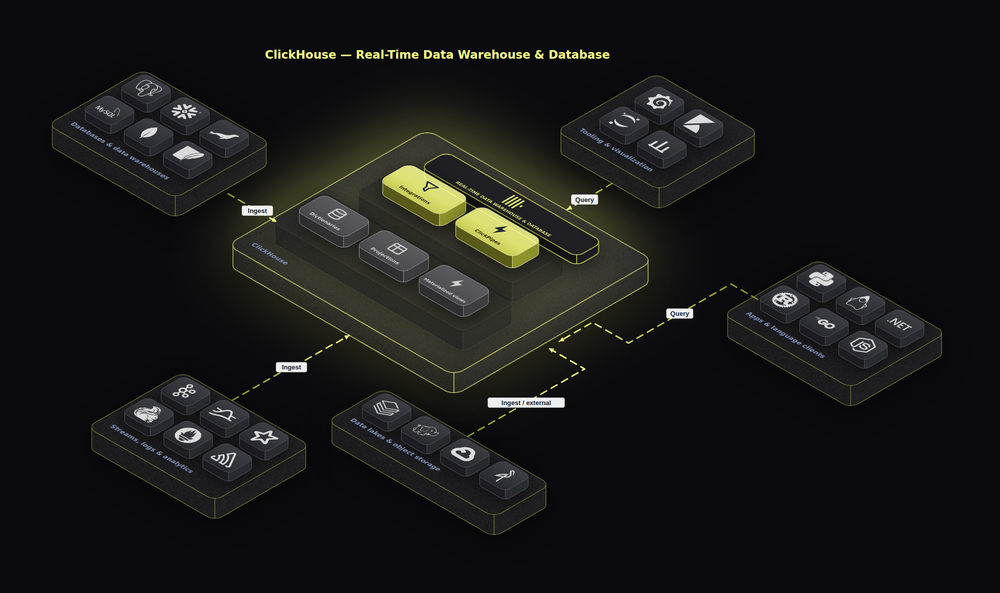
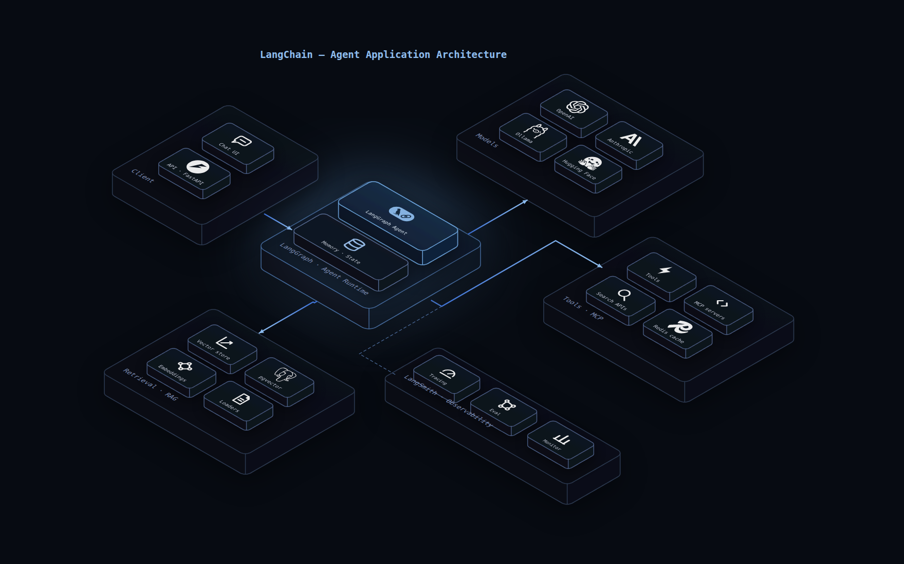
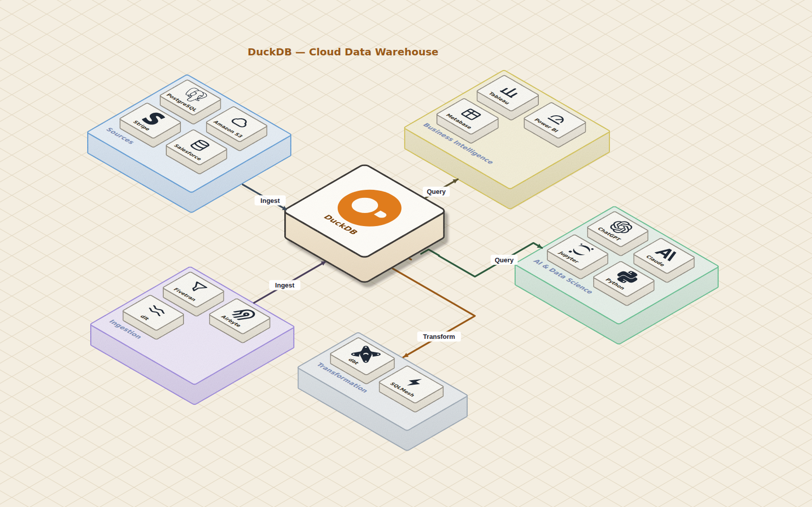
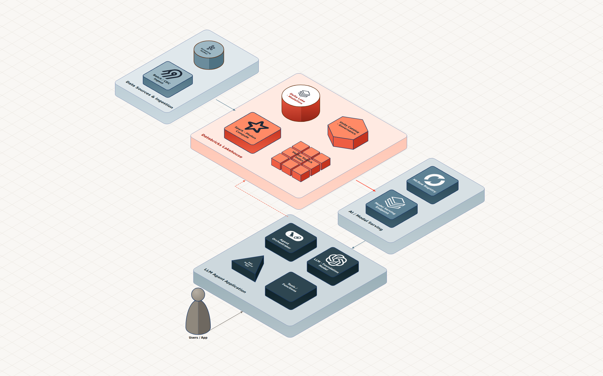
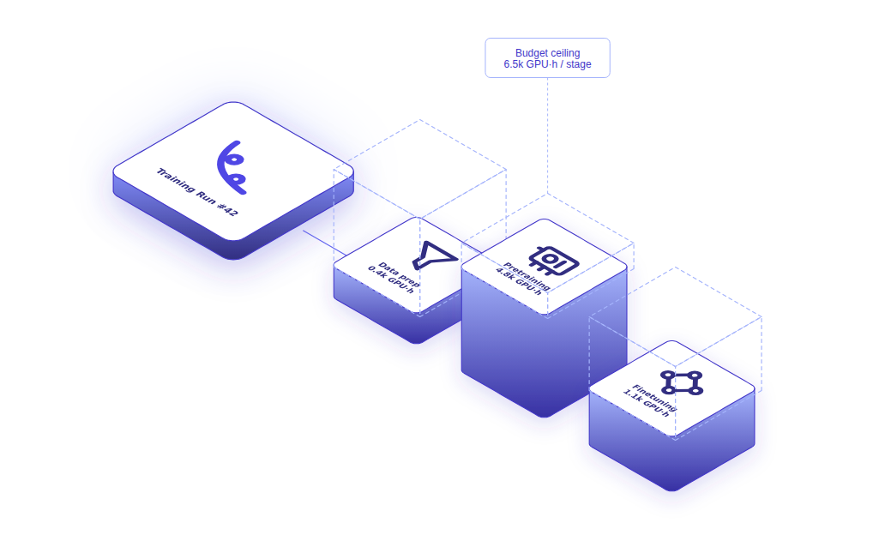

<div align="center">


# iso-topology — 用代码画出设计稿级别的 2.5D 架构图

[](LICENSE)
[](https://go.dev)
[](https://pkg.go.dev/github.com/MarkovWangRR/iso-topology)

**对 AI 说出你的需求，或者写下几行简单的代码，即可生成极具质感的 2.5D 等距架构图。**



<sub>↑ 这张图就是“问”出来的：“画一个 ClickHouse 实时分析架构，用暗色玻璃风格”。接着再补充几句微调：“连线加粗改成虚线”、“背景加个斜向网格”、“点缀色用青柠色”。不需要开 Figma，也不用算坐标，你只需要一段能存进 Git 的文本。</sub>

`单文件静态编译` · `零运行时依赖` · `毫秒级极速渲染` · `内置 200+ 精美图标` · `全样例 Golden 测试覆盖`

**[官方文档](https://iso-topology.mintlify.site/) · [快速上手](https://iso-topology.mintlify.site/quickstart) · [图例展示](https://iso-topology.mintlify.site/gallery)**

[English](README.md) · 简体中文

</div>

---

作为开发者，我们都喜欢用代码画图（Mermaid, D2），因为它们能存进 Git，方便追踪变更。但缺点也很明显：画出来的 2D 框图往往非常单调乏味，很难直接放到官网或产品发布会上展示。如果要追求效果，我们只能去 Figma 里一根线一根线地死磕 2.5D 坐标，一旦架构有变，整张图就得重画。

**iso-topology** 就是为了解决这个痛点而生的。它是一个单文件 Go 命令行工具（也可作为库引用），能把一份极其简单的文本声明（DSL）编译成媲美专业设计师手绘的 2.5D 等距 SVG 架构图。

更重要的是，它**为 AI Agent（智能体）量身定制**。Agent 可以在渲染前进行语法校验并自我纠错，生成绝对确定且每次结果完全一致的文件。

## 💡 手写？也完全没问题！

忘记那些复杂的像素和坐标吧！你只需要定义组件的关系（比如“在 API 网关后面加个数据库”），剩下的全都交给内置的布局求解器。

看下面这段简单的 YAML：

```yaml
theme:
  presets:
    heroBlue:                                  # 设定全图唯一的发光强调色，随时复用
      stroke: { color: "#6FA8E0", width: 1.6 }
      faces: { top: { fill: { kind: linearGradient, stops: [ {offset: 0, color: "#1A3550"}, {offset: 1, color: "#0E1C30"} ] } } }
      effects: { faceSplit: true, backglow: { color: "#6BA8E8", radius: 70 } }
nodes:
  scene:
    parts:
      - id: runtime
        shape: group
        layout: { mode: column }               # ← 让它自动纵向排布，完全不写坐标
        parts:
          - { id: agent,  preset: heroBlue, icon: "iso://si/langchain/8FBEEF", label: "LangGraph Agent" }
          - { id: memory, icon: "iso://glyph/database", label: "Memory · State" }
    connectors:
      - { from: client, to: runtime, routing: orthogonal,
          stroke: { gradient: { from: "#3B6FD4", to: "#8FBEEF" } } }   # 让数据流连线发光
```

……稍等片刻，它就会渲染出这张充满冷调科技感的 LangChain Agent 应用架构图：



[查看完整源码](samples/topology/langchain-app/input.yaml)。

## 🚀 60 秒极速上手

### 选项 A：自己动手（单文件，无需任何额外环境）
```bash
# 1. 安装 CLI
go install github.com/MarkovWangRR/iso-topology/cmd/isotopo@latest

# 2. 随便写一段 d2 格式的关系流
echo 'user -> api -> db' > scene.d2

# 3. 渲染出图！
isotopo render scene.d2 ./out           # 输出包含 SVG、HTML 交互预览等

# 4. 边改边看
isotopo serve  scene.d2                 # 访问 localhost:8731 进入可视化 Studio 界面
```

### 选项 B：交给你的 AI Agent（Claude, Cursor 等）
这是它最强大的玩法（以下命令均已验证可用）：

```bash
go install github.com/MarkovWangRR/iso-topology/cmd/isotopo@latest      # 渲染核心
go install github.com/MarkovWangRR/iso-topology/cmd/isotopo-mcp@latest  # MCP 服务
claude mcp add isotopo -- isotopo-mcp                                   # 一键接入 Claude Code
```

搞定后，直接在聊天框里对 AI 说：
> *“帮我画一个 ClickHouse 实时分析架构，用暗黑玻璃风格。”*
> *“把连线加粗，换成带渐变的虚线。”*
> *“背景加上斜向网格，顺便把节点的描边提亮一点。”*

你的 Agent 会在后台自动完成所有的排版、校验和渲染。如果你不想配置 MCP，也可以直接运行本仓库里的 `scripts/install-skill.sh` 安装 Claude 技能。完整的系统提示词请参考 [PROMPT_TEMPLATE.md](docs/agent/PROMPT_TEMPLATE.md)。

## 🤖 专为 AI Agent 设计的“自我纠错”工作流

为什么现有的 AI 很难画好复杂的拓扑图？因为它们算不准 2.5D 坐标。
iso-topology 彻底改变了这一点：它提供了一套基于契约、能自我纠错的完整闭环。

```bash
isotopo capabilities          # 给 AI 看的说明书：支持什么形状、什么参数（每次会话读一次即可）
isotopo validate scene.yaml   # 代码校验器：报错会精确到具体行，甚至包含“你是不是想拼写 xxx”的修复建议
isotopo evaluate scene.yaml   # 评分系统：客观评估是否有组件交叉、重叠或是失衡
isotopo repair   scene.yaml --compose --write   # 自动修复器：自动推开重叠的组件、吸附对齐，并把改动写回源文件
isotopo render   scene.yaml out
isotopo snapshot scene.yaml out                 # 附带生成光栅化的 png 供视觉核对
isotopo preview  scene.yaml out.svg core edge:3   # 局部预览功能
```

在生成哪怕一个像素之前，Agent 就能在 `validate` -> `evaluate` -> `repair` 的闭环中完成排版纠错和遮挡修复。这一切都是字节级确定的——只要输入不变，输出的文件永远一模一样。

## ⚙️ MCP 服务接入

`isotopo-mcp` 将整个工作流打包成了 7 个标准 MCP (Model Context Protocol) 工具。Claude Desktop、Cursor 或是任何支持 MCP 的客户端，都能零配置直接接入画图能力：

```json
{
  "mcpServers": {
    "isotopo": { "command": "isotopo-mcp" }
  }
}
```

了解更多 MCP 配置细节：[docs/agent/MCP.md](docs/agent/MCP.md)。

## 🎨 Studio：在浏览器里沉浸式调校

```bash
isotopo serve input.yaml        # 打开 http://localhost:8731
```


不想在终端里反复敲命令？直接在 Studio 里边改边看。
左边是实时渲染的 2.5D 场景，右边是可编辑的 YAML 代码，改动亚秒级生效。你甚至可以**直接用鼠标拖拽组件排版**、支持多选框选、一键切换“等距 / 2D 平面”视图、右键快捷修改样式，最后导出 SVG / PNG。所有的编辑都在浏览器副本内进行，除非你点击保存，否则绝对不会破坏你的源文件。详见 [Studio 导览](docs/guides/studio.md)。

## ✨ 核心能力一览

- **18 种 2.5D 几何体**：方块、圆柱、棱柱（三/六/八面）、机架、阵列（1D/2D/3D）、云、人形、边界等，充分表达复杂的业务语义。
- **真正的零坐标自动布局**：用相对关系（`rightOf`, `behind`, `above`）或容器模式（`row`, `column`, `grid`, `ring`），甚至直接让图引擎自动排布（`auto`），彻底告别算坐标的折磨。
- **顶级的视觉样式**：支持毛玻璃半透明、逐面渐变、底纹（点阵/斜纹）、投影、辉光、圆角、胶片颗粒噪声（Grain），随心所欲定制风格。
- **专业的正交连线（Orthogonal Routing）**：连线会自动沿着等距网格绕开障碍物（`orthogonal2`），支持自定义虚线、渐变色、途经点及标签。
- **一键切换 2D 俯视模式**：在渲染时加上 `--projection top`，设计稿级别的 2.5D 图瞬间降维成最清晰的 2D 架构说明图。一套代码，两种用途。（见 [2D 模式样例](samples/topology/plan-view-2d/input.yaml)）。
- **200+ 免费正版图标**：内置 150+ 个来自 [Simple Icons](https://simpleicons.org) 的大厂 logo，加 35 个手绘概念图。支持随意变色（例如 `/RRGGBB`）。

## 🖼️ 画廊：看看大家都在画什么

**ClickHouse 实时分析生态** —— 暗黑毛玻璃轮辐结构，炫酷的霓虹点缀。[源码](samples/topology/clickhouse-hub/input.yaml)


**DuckDB 手绘风格数据架构** —— 温暖的纸张质感、等距网格和胶片颗粒。[源码](samples/topology/duckdb-handdrawn/input.yaml)


**Databricks 湖仓 + AI Agent** —— 品牌原生的高级感，暖白色画布上唯一的 Lava 橙红强调。[源码](samples/topology/lakehouse-agent/input.yaml)


**训练算力消耗图** —— 用等距柱状图和虚线框，直观展示算力账单的“幽灵”体积。[源码](samples/topology/training-compute/input.yaml)


## 📦 作为 Go 语言库嵌入

你也可以把它当成一个普通的 Go package 引入你的系统里：

```go
import isotopo "github.com/MarkovWangRR/iso-topology"

// 把文本 DSL 直接渲染成 SVG
svg, issues, _ := isotopo.RenderSource("yaml", yamlBytes)

// 甚至支持对画板进行无状态的增删改查
op := isotopo.EditOp{Kind: "move", Target: "node", ID: "api", DWX: 50}
newSrc, svg, issues, _ := isotopo.ApplyOp("yaml", yamlBytes, op) // 编辑源码，原样保留注释
```

这套极其灵活的无状态编辑 API，正是支撑前面提到的强大交互式 Studio 的底层核心。[点击查看完整 API 文档](docs/reference/api.md) ([GoDoc](https://pkg.go.dev/github.com/MarkovWangRR/iso-topology))。

## 📚 详细文档

你想了解的一切都在 [docs/README.md](docs/README.md) 里：

- **入门必读：** [快速教程](docs/getting-started/01-install.md) · [常用写法速查](docs/agent/RECIPES.md) · [视觉设计指南](docs/guides/scene-design.md)
- **硬核参考：** [API 文档](docs/reference/api.md) · [CLI 命令](docs/reference/cli.md) · [YAML 语法](docs/reference/dsl-yaml.md) · [d2 语法](docs/reference/dsl-d2.md)
- **Agent 开发：** [能力清单](docs/agent/CAPABILITIES.md) · [提示词模板](docs/agent/PROMPT_TEMPLATE.md) · [MCP 指南](docs/agent/MCP.md)

## ❤️ 项目状态与开源参与

本项目是一个快速迭代中的个人开源项目。如果你要在生产代码中引入它，强烈建议锁定某个 tag 版本。欢迎各位提交 Issue 和 PR！

（请注意：在提交 PR 前务必跑一遍 `go test ./...`，任何微小的视觉漂移都会被极其严格的 Golden 测试拦下。）

**如果你用它画出了很棒的作品？** 欢迎开个 Issue 晒出你的截图和源码，我会把它加进画廊。如果它帮你省下了被 Figma 折磨的时间，**求点个 ⭐ 星星支持一下！**

---
*Apache License 2.0 开源授权。渲染产物版权完全归你，可放心商用。*
